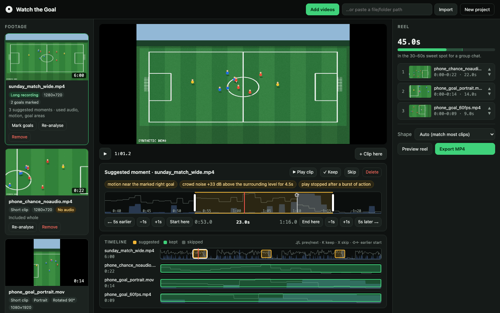

# Watch the Goal

[](https://github.com/faizm10/watch-the-goal/actions/workflows/ci.yml)
[](https://github.com/faizm10/watch-the-goal/releases)
[](pyproject.toml)
[](LICENSE)
[](#captions-with-ai-optional)
[](CONTRIBUTING.md)

Turn your Sunday pickup footage into one highlight reel, buildup included.

Drop in a whole match, a few phone clips, or both. Watch the Goal suggests the
moments worth keeping and says why ("crowd noise +14 dB for 2.5s"). You keep
or skip each one, nudge its start back to catch the assist, and export one MP4
for the group chat.

Everything runs on your machine: no account, no upload, no GPU. Your original
files are never modified.



## Quickstart

You need Python 3.10+, [uv](https://docs.astral.sh/uv/) and FFmpeg.

```sh
brew install ffmpeg uv                                                      # macOS
sudo apt install ffmpeg && curl -LsSf https://astral.sh/uv/install.sh | sh  # Ubuntu / Debian
winget install Gyan.FFmpeg astral-sh.uv                                     # Windows
```

Then, from a clone of this repo:

```sh
uv run watch-the-goal                      # opens http://127.0.0.1:8765
uv run watch-the-goal ~/Movies/match.mp4   # or open a recording straight away
```

Projects and exports live in `~/WatchTheGoal` (change it with `--workspace`).
Without uv: `pip install .` then `watch-the-goal`.

## How to use it

1. **Import.** Click **Add videos**, drop files on the page, or paste a file or
   folder path. MP4, MOV, M4V, MKV and WebM all work, including iPhone HEVC and
   portrait video. Long recordings are analysed (about a minute per hour of
   1080p) and get suggested moments; short clips go straight into the reel.
2. **Trim the match** (optional). Click **Trim match** on a recording and set
   kick-off, halftime and full time from the playhead. Everything outside is
   ignored and greyed out.
3. **Review.** Walk the suggestions with `J` / `L`, keep with `K`, skip with
   `X`. Drag a clip's edges, or press **⟵ 5s earlier** to catch the buildup.
   Press `N` to add a clip anywhere detection missed.
4. **Tag** as you watch: `1` goal, `2` save, `3` near miss, `4` chance, `5`
   tackle, `0` not a highlight. Each tag explains what the detector measured
   there. **Re-tune from my calls** then adjusts the detector to agree with you
   and re-ranks the suggestions.
5. **Arrange.** Drag clips in the Reel panel, aim for 30–60 seconds, and press
   **Preview reel**. **Auto-fill from suggestions** keeps the strongest ones
   for you (one **Undo** reverts it).
6. **Make it a recap** (optional). Choose **Match recap** to add an opening
   title, scoreboards, a caption on each clip (`GOAL · 47'`), fades between
   clips and an end card. **Write** drafts the words for you (see below).
7. **Export.** Pick a shape (auto, 16:9, 9:16 or 1:1) and click **Export MP4**.

### Getting around a recording

| Key | Action |
| --- | --- |
| `Space` | play / pause |
| `J` / `L` | previous / next clip |
| `K` / `X` | keep / skip |
| `N` | new clip at the playhead |
| `1`–`5`, `0` | tag goal, save, near miss, chance, tackle; not a highlight |
| `[` / `]` | set start / end at the playhead |
| `Shift+←` / `Shift+→` | start 5 s earlier / end 5 s later |
| `←` / `→` | back / forward 2 s |
| `,` / `.` | one frame back / forward |
| `<` / `>` | slower / faster (0.5× to 4×) |
| `+` / `-` | zoom the timeline |
| `D` | live detection overlay |
| `Ctrl/⌘ Z` | undo |

You can also drag along a track to scrub (a frame preview follows the pointer),
zoom with Ctrl/⌘ + scroll or a pinch, and pan with Shift + scroll.

### Captions with AI (optional)

In the recap dialog, **Write** fills in the title, captions and end card.

- **Tags and detection** (the default) works offline from your tags, the
  detector's notes, the scoreboard and the match minute.
- **Claude, OpenAI or Gemini** write it instead. Run `uv sync --extra ai`, then
  paste a key or set `ANTHROPIC_API_KEY`, `OPENAI_API_KEY` or `GEMINI_API_KEY`
  before starting the app.

Only text is sent (team names, score, minutes, tags and detector notes), never
footage or file names. A pasted key stays in memory until you quit and is never
saved. Nothing changes until you click **Save recap**.

### Optional local extras

Open **Analysis** to download a small player detector (YOLOX or RF-DETR Nano,
one click) or to turn on AI review by a vision model you run locally with
[Ollama](https://ollama.com). Both stay on your machine. For a fixed camera,
**Mark goals** so movement in each goal mouth counts as evidence too.

## How detection works

FFmpeg reads each recording once and measures loudness and motion. A moment is
suggested when it hears sustained crowd noise, sees movement in a marked goal,
sees play stop after a burst of action, or, on an auto-panning camera like
Veo, sees the camera follow play to one end. Each clip starts about 10 s early
to keep the buildup, and runs 5 to 15 s.

Real-world recall is still unmeasured, so expect to add some clips yourself.
See [docs/DETECTION.md](docs/DETECTION.md) for the details and
[docs/BENCHMARKS.md](docs/BENCHMARKS.md) for the numbers. Labelled matches are
very welcome.

## Known limitations

- Suggestions come from sound and motion. The optional detector finds people,
  not the ball. Quiet goals are easy to miss; indoor domes and people walking
  past the lens cause false alarms.
- AI review is slow (about 30 s per suggestion) and often wrong on distant
  footage. Treat it as a second opinion.
- Multiple files are separate recordings; there's no automatic syncing.
- Dropped files are copied into the workspace. For big match files, paste the
  path instead so it's read in place.
- Export re-encodes on the CPU (about 10× realtime for 1080p on an M-series Mac).

## Command line

```sh
watch-the-goal [VIDEOS_OR_FOLDERS...] [--workspace DIR] [--port 8765] [--no-browser]
watch-the-goal detect match.mp4 [--goal x,y,w,h ...] [--detector none|yolox|rfdetr-nano] [--review]
watch-the-goal models [list | download yolox rfdetr-nano]
```

## Development

```sh
uv sync
uv run pytest -q
```

Tests build their own small videos with FFmpeg. CI also renders a synthetic
demo match (`scripts/make_demo.py`, see [demo/README.md](demo/README.md)) and
drives the real UI in a browser (`scripts/e2e_ui.py`). See
[CONTRIBUTING.md](CONTRIBUTING.md).

## Community

- Found a bug or have an idea? [Open an issue](https://github.com/faizm10/watch-the-goal/issues/new/choose).
- Security problem? Please report it privately, see [SECURITY.md](SECURITY.md).
- What changed in each release: [CHANGELOG.md](CHANGELOG.md).
- Everyone taking part follows the [Code of Conduct](CODE_OF_CONDUCT.md).

## License

[MIT](LICENSE). Third-party packages and models are listed in
[THIRD_PARTY_NOTICES.md](THIRD_PARTY_NOTICES.md).
